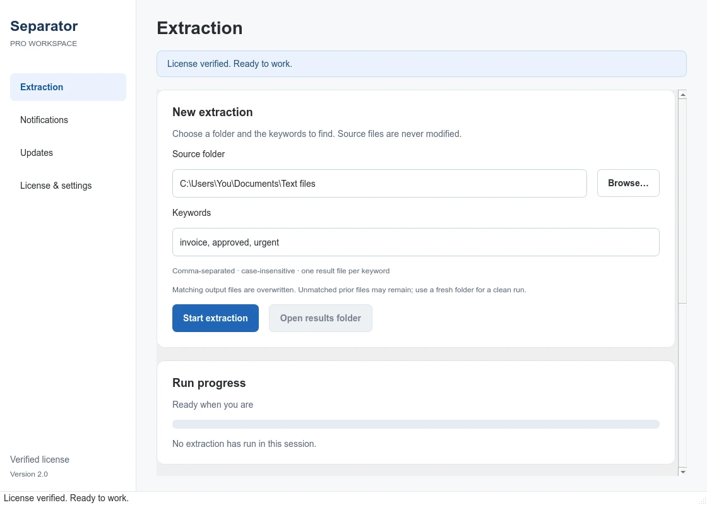

<div align="center">


# Separator Pro

### Find the lines that matter. Extract them in seconds.

**A focused Windows desktop tool for searching keyword-matching lines across text files.**

Scan nested folders, collect matching lines, and save organized results—without modifying your original text files.

**Built by [Jonayed Lab](https://github.com/jonayedlab) · Windows desktop · Commercially licensed**

<p>
  <a href="https://github.com/jonayedlab/Separator-Pro/releases/latest">
    
  </a>
  <a href="https://wa.me/8801924705551?text=Hello%20Jonayed%20Lab%2C%20I%27d%20like%20to%20buy%20Separator%20Pro.">
    
  </a>
</p>

[Features](#features) · [Quick start](#quick-start) · [License plans](#license-plans) · [FAQ](#frequently-asked-questions) · [Contact](#contact-jonayed-lab)

</div>

---



> Interface preview uses sample data. The appearance may vary with Windows version and display scaling.

## About Separator Pro

Separator Pro is a Windows text-file search and keyword extraction application from Jonayed Lab. It helps you find lines containing specific words or phrases across `.txt` files—including files inside nested folders—and save the matching lines into separate, organized output files.

Instead of opening files one by one, select a folder, enter your keywords, and run an extraction session from one desktop workspace.

## Features

- **Recursive text-file scanning:** Search `.txt` files in a selected folder and its subfolders.
- **Multiple keywords:** Process a comma-separated list of keywords in one session.
- **Case-insensitive matching:** Match text regardless of capitalization.
- **Organized output:** Save matching lines in separate files under the `mals` output folder.
- **Sorted, deduplicated results:** Remove duplicate lines and sort results within each keyword's output.
- **Progress and session history:** Track processing progress and review results from the current session.
- **Source-file preservation:** The extraction workflow does not modify the original text files.
- **Text encoding detection:** Detect text encoding and handle unreadable characters with replacement where necessary.
- **Online license management:** Activate and verify a valid license for the current installation.
- **License status and expiry:** View the license type, expiry, reported features, and device-slot information supplied by the service.
- **Notifications and update checks:** Read owner notifications and check for available software updates.
- **Device deactivation:** Deactivate the current installation when you need to free its license slot.
- **Windows credential protection:** Protect saved credentials using Windows per-user DPAPI.

### Local processing and online license checks

The text extraction workflow runs on your computer. The application contacts the license service for activation, verification, license status, notifications, and updates. Those requests include license/device metadata—not the contents of the text files being scanned.

## Download Separator Pro for Windows

<div align="center">

### Get the official release

Use the download button below to open the project's GitHub Releases page. Choose the latest release and download the published `separator.exe` asset, if available.

**[⬇️ Download Separator Pro — Latest Release](https://github.com/jonayedlab/Separator-Pro/releases/latest)**

Need help getting the software or choosing a license?

**[Contact Jonayed Lab on WhatsApp](https://wa.me/8801924705551?text=Hello%20Jonayed%20Lab%2C%20I%27d%20like%20the%20official%20Separator%20Pro%20download%20and%20license%20details.)** · [Email](mailto:jonayedlab@gmail.com?subject=Separator%20Pro%20download%20and%20license)

</div>

> **Repository setup required:** 

Only download releases published by Jonayed Lab. Verify a published checksum when available; a checksum by itself is not a digital signature.

## Requirements

| Requirement | Details |
| --- | --- |
| Operating system | Windows desktop; target Windows 10/11 x64. Confirm compatibility with your particular release. |
| Python | Not required when running the distributed `separator.exe`. |
| License | A valid Separator Pro license. |
| Internet connection | Required for activation and ongoing license/service checks. |
| File permissions | Read access to source files and write access to the selected folder's `mals` output directory. |
| Storage and memory | Enough disk space and memory for your dataset and extracted results. |

Very large datasets may require substantial memory because matching lines are collected before output is written. Separator Pro is not advertised as an unlimited-size or zero-memory-use processing engine.

## Quick start

### 1. Download the application

1. Open the [latest GitHub Release](https://github.com/jonayedlab/Separator-Pro/releases/latest).
2. Download the official `separator.exe` asset, if it is available.
3. Save it in a folder where you have permission to run applications.
4. If no release asset is available, contact [Jonayed Lab on WhatsApp](https://wa.me/8801924705551?text=Hello%20Jonayed%20Lab%2C%20I%27d%20like%20the%20official%20Separator%20Pro%20download.).

### 2. Activate your license

1. Open `separator.exe`.
2. Enter your license key in the activation screen.
3. Wait for the license service to approve activation.
4. Open the extraction workspace.

On later launches, a saved installation is verified through heartbeat. Do not delete configuration or installation-identity files to work around an error; doing so may lead to an additional activation later.

### 3. Extract matching lines

1. Click **Browse** and choose the folder containing your `.txt` files.
2. Enter keywords separated by commas. For example:

   ```text
   invoice, approved, urgent
   ```

3. Click **Start extraction**.
4. Review the progress and result summary.
5. Click **Open results folder** to inspect the output.

### Example folder structure

```text
Your source folder/
├── records.txt
├── archive/
│   └── notes.txt
└── mals/
    ├── invoice.txt
    ├── approved.txt
    └── urgent.txt
```

A keyword file is written when matching lines are found. Output lines are sorted and deduplicated **within each keyword's result**. A line containing multiple keywords can appear in multiple result files.

> **Output behavior:** Existing matching output files are overwritten. Old output files for keywords with no matches may remain from a previous run. Use a fresh working folder when you need a completely clean result set, and back up important existing results.

## License plans

The following USD list prices are the proposed launch schedule. Confirm the final order, device allowance, payment method, taxes, and applicable support/refund terms with Jonayed Lab **before paying**. All terms require a valid issued license; this README does not process payments or create licenses automatically.

| License term | List price (USD) | Payment structure |
| --- | ---: | --- |
| 1 month | **$9** | One payment for the stated term |
| 3 months | **$24** | One payment for the stated term |
| 6 months | **$39** | One payment for the stated term |
| 1 year | **$69** | One payment for the stated term |
| 3 years | **$149** | One payment for the stated term |
| Lifetime | **$249** | One-time license; no fixed license-expiry date |
| Custom | **Request a quote** | Scope and license conditions agreed before purchase |

### License terms

- The issued key and server policy determine device limits, features, activation eligibility, and expiry.
- Fixed-term licenses require renewal if you want to continue after expiry. Automatic renewal billing is not implemented through this README.
- A lifetime license describes the license's expiry setting. It does **not** promise perpetual service hosting, all future major versions, unlimited devices, or unlimited support.
- Custom licensing may be discussed for a specific duration, deployment, or device allowance; availability must be confirmed.
- Changing keys does not free the old key's slot. Deactivate the old installation when appropriate.

<div align="center">

**Ready to get started?**

[**Ask about a license on WhatsApp**](https://wa.me/8801924705551?text=Hello%20Jonayed%20Lab%2C%20I%27d%20like%20to%20discuss%20a%20Separator%20Pro%20license.) · [Email Jonayed Lab](mailto:jonayedlab@gmail.com?subject=Separator%20Pro%20license%20inquiry)

</div>

## Updates and notifications

Open **Updates** to check for a newer release and **Notifications** for owner-supplied messages.

- Optional updates let your licensed current version continue.
- A known mandatory update blocks new extraction until the new version is installed.
- Downloads are **staged only**. Even when the service requests automatic downloading, the application does not silently run or install a downloaded program.
- Verify the official artifact, close the old application, and install the new release manually.
- Downloading a mandatory update does not unlock the old version by itself.

The current API does not define a signed release/installer protocol. Do not assume that a downloaded artifact is developer-authenticated solely because a local SHA-256 is displayed.

## License settings and recovery

Open **License & settings** to inspect license information, copy the installation ID, verify the saved license, read public product policy, or deactivate the current device.

Saved state lives under:

```text
%USERPROFILE%\.keyword_extractor_pro\
```

- `license.dpapi` contains Windows-protected credential data.
- `installation_id` preserves the device identity.
- `updates\` contains staged release artifacts.

DPAPI protects stored credentials for the current Windows user; it is not a guarantee against administrators, malicious code running as that user, or a modified application.

If credentials become unreadable, the GUI offers an explicit key-storage recovery flow only when an existing device identity can be preserved. It still requires normal server-approved activation. **There is no embedded emergency password or offline license bypass.** Contact Jonayed Lab for license-owner assistance.

## Troubleshooting

| Situation | What to do |
| --- | --- |
| Activation limit reached | Deactivate an installation you no longer use, or ask the owner about your allowance. Do not regenerate device IDs. |
| Expired, suspended, blocked, or revoked license | Contact Jonayed Lab. Do not attempt to bypass the service decision. |
| Service/network error | Check connectivity and network policy, then retry. Online verification is required. |
| Too many requests / HTTP 429 | Wait for the service's indicated retry period before trying again. |
| No results | Check the folder, `.txt` extension, keyword spelling, and extraction details. Matching is case-insensitive but still literal. |
| Cannot save results | Choose a writable folder and check available disk space and file permissions. |
| A keyword is rejected | Keywords become filenames. Avoid Windows-reserved names, path separators, trailing dots, and other forbidden characters. |
| App is already running | Use or close the existing GUI instance before opening another. |
| A security warning appears | Verify the official source and release. Do not disable security software. Ask the owner about signing/reputation status. |

If a task is running, allow it to finish before closing the application. Extraction is not force-terminated midway through output writes.

## Frequently asked questions

### Is Separator Pro free?

Separator Pro is commercially licensed software. A valid license is required to use the licensed application. Contact Jonayed Lab for current purchase and license details.

### Does it modify my original text files?

The extraction workflow does not modify the source text files. It writes matching results to the output folder. Note that existing matching output files can be overwritten.

### Do I need Python installed?

Python is not required when running the distributed `separator.exe`.

### Does activation require internet access?

Yes. Internet access is required for activation and ongoing license/service checks.

### Where can I download the latest version?

Use the **Download Latest Release** link near the top of this README. It will work after the repository URL is configured and a release asset has been published.

### Can I use one license on multiple computers?

Device limits and activation eligibility are determined by the issued license and server policy. Contact Jonayed Lab to confirm the allowance for your plan.

### Does a lifetime license include every future version and unlimited support?

No. A lifetime license refers to the license's expiry setting. It does not automatically guarantee perpetual hosting, every future major version, unlimited devices, or unlimited support.

## Security and responsible use

- No application running on a customer's own computer can honestly be guaranteed “uncrackable.”
- Compiled distribution makes casual plaintext source inspection harder; it does not eliminate reverse engineering or binary patching.
- Never publish license keys, recovery credentials, DPAPI files, or private signing material in GitHub issues or repositories.
- Scan only files you own or are authorized to process.
- Back up important data and validate results before relying on them in a critical workflow.

## Contact Jonayed Lab

| Channel | Contact |
| --- | --- |
| Developer / Agency | **Jonayed Lab** |
| Email | [jonayedlab@gmail.com](mailto:jonayedlab@gmail.com) |
| WhatsApp | [+880 1924-705551](https://wa.me/8801924705551) |
| GitHub | [@jonayedlab](https://github.com/jonayedlab) |

For support, include your app version, Windows version, exact error message, and installation ID when relevant. **Do not send your license key in a public issue.**

## Distribution and licensing

Separator Pro is commercially licensed software from Jonayed Lab. Contact the owner for purchase, redistribution, source-access, and commercial-use terms. A public GitHub repository or a published executable is not, by itself, an open-source license grant.

Third-party libraries retain their own licenses. Release owners must review and fulfill the obligations of the exact Qt/PySide, runtime, and other dependencies they distribute. This README does not replace an agreed software license, privacy notice, refund policy, or third-party notices.

---

<div align="center">

**Separator Pro**  
*A focused Windows text extraction workspace by Jonayed Lab.*

[Website / GitHub](https://github.com/jonayedlab) · [Email](mailto:jonayedlab@gmail.com) · [WhatsApp](https://wa.me/8801924705551)

</div>
